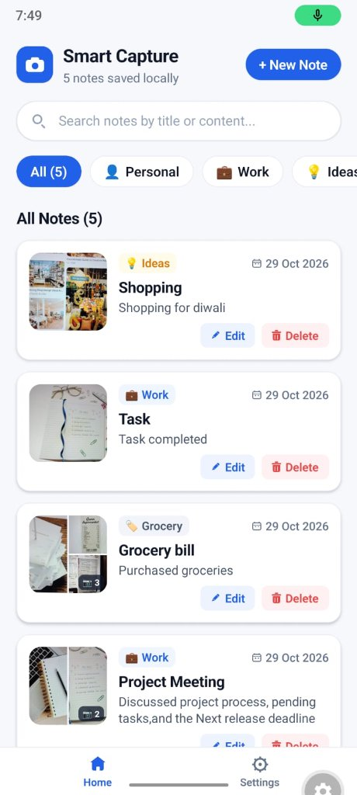
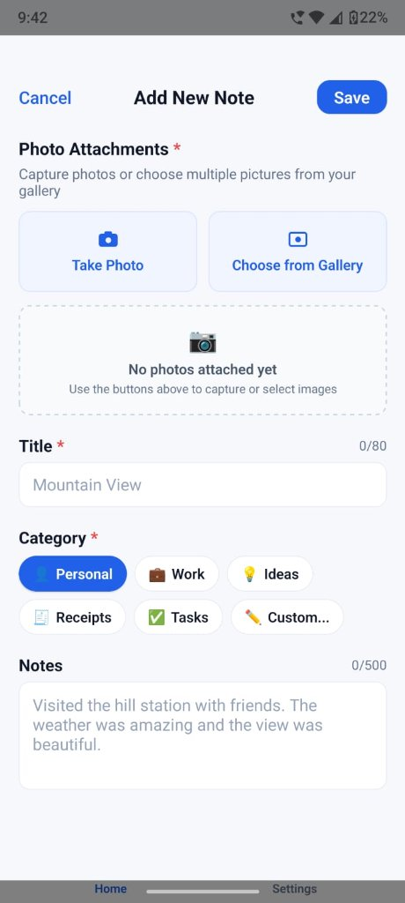
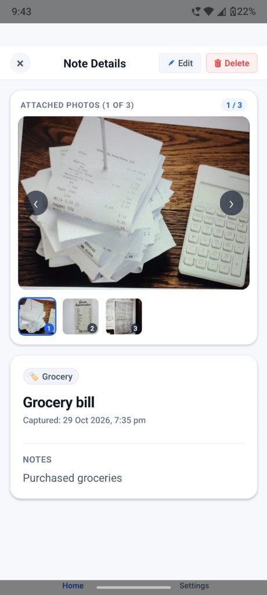

# Smart Capture & Notes App

**DesiCrew Solutions Mobile App Developer Internship Assignment**  
Built with **React Native**, **Expo SDK 58**, and **TypeScript**.

---

## 1. Project Overview

**Smart Capture & Notes** is an offline-first visual note-taking mobile application. It allows users to capture photos using the device camera or select images from the gallery, attach structured metadata such as a title, category, and notes, and organize records using real-time search and category filtering.

All note metadata and photo files are stored locally on the device without requiring a backend service or user authentication.

---

## 2. Technologies Used

| Technology | Purpose |
|---|---|
| React Native (`0.88.1`) | Cross-platform mobile application framework |
| Expo SDK (`~58.0.21`) | Development tooling and runtime environment |
| TypeScript (`~6.0.3`) | Type safety and static code analysis |
| `@react-native-async-storage/async-storage` (`2.2.0`) | Local key-value storage for note metadata |
| `expo-file-system` (`~58.0.13`) | Local image file management |
| `expo-image-picker` (`~58.0.10`) | Camera capture and gallery image selection |
| `expo-status-bar` (`~58.0.4`) | System status bar styling |

---

## 3. Features

### Core Features

- **Camera Capture:** Capture photos using the device camera.
- **Gallery Selection:** Select existing images from the device photo library.
- **Image Preview:** Preview selected photos and remove attachments.
- **Structured Note Fields:** Add a required title (maximum 80 characters), a category, and optional notes (maximum 500 characters).
- **Category Options:** Personal, Work, Ideas, Receipts, Tasks, and Custom.
- **Record Management:** Create, view, edit, and delete notes.
- **Search and Filtering:** Search records by keyword and filter by category.
- **Validation and Error Handling:** Handle form validation, permissions, and missing image files.

### Bonus Feature Implemented

- **Multiple Image Attachments per Record:** Attach multiple photos to a note, display image thumbnails on note cards, and browse images in the detail view. Backward compatibility with legacy single-image records is maintained in the storage model.

---

## 4. Setup and Run Instructions

### Prerequisites

- Node.js (v18+)
- pnpm or npm
- Expo Go on an Android or iOS device, or a compatible emulator

### Steps

1. Open a terminal and navigate to the project directory:

   ```bash
   cd SmartCaptureNotes
   ```

2. Install the dependencies:

   ```bash
   pnpm install
   # or: npm install
   ```

3. Start the development server:

   ```bash
   pnpm start
   # or: npx expo start
   ```

4. Open the app:
   - Scan the terminal QR code using Expo Go on a physical device.
   - Or press `a` for Android Emulator / `i` for iOS Simulator.

---

## 5. Storage Approach

The app uses local storage for note metadata and image files.

- **Note Metadata:** Note details, including IDs, titles, notes, categories, timestamps, and image paths, are serialized as JSON and stored using `@react-native-async-storage/async-storage` under key `@smart_capture_notes_records_v1`.
- **Image Files:** Captured and picked photos are copied to the app's persistent document directory (`smart_capture_images/`) using `expo-file-system`, preventing the OS from clearing temporary cache files.
- **File Management:** Image files are safely unlinked only when no remaining record references them. Legacy single-image records are automatically normalized to the multi-image format on load without data loss.

---

## 6. Application Architecture

The application is organized around a root component, reusable UI components, utilities, types, and constants.

```text
SmartCaptureNotes/
├── App.tsx                      # Root screen: state, search/filter, and modal coordinator
├── index.ts                     # Expo root entry point
├── package.json                 # Dependencies and npm scripts
├── tsconfig.json                # TypeScript strict configuration
├── screenshots/                 # Application screenshots
│   ├── app_home_screen.jpg      # Home screen runtime screenshot
│   ├── create_note.jpg          # Create note screen runtime screenshot
│   └── note_details.jpg         # Note details screen runtime screenshot
└── src/
    ├── constants/               # Category definitions and theme tokens
    ├── types/                   # TypeScript interfaces and data models
    ├── utils/                   # Local storage, file system, and model helpers
    └── components/              # Reusable UI components
```

### Key Components and Modules

- **`App.tsx`:** Main application component, state coordination, and list filtering.
- **`src/components/`:** Reusable UI components for record cards (`RecordCard.tsx`), forms (`RecordFormModal.tsx`), details (`RecordDetailModal.tsx`), search (`SearchBar.tsx`), category filters (`CategoryFilter.tsx`), confirmation dialogs (`ConfirmModal.tsx`), settings (`SettingsView.tsx`), and navigation (`BottomNavBar.tsx`, `Header.tsx`, `ActionIcons.tsx`).
- **`src/utils/`:** Local data storage (`recordStorage.ts`), persistent file management (`fileStorage.ts`), and normalization logic (`recordModel.ts`).
- **`src/types/`:** TypeScript interfaces and data types (`record.ts`).
- **`src/constants/`:** Category definitions (`categories.ts`) and theme configuration (`theme.ts`).

---

## 7. Screenshots 

The following screenshots were captured from the running application using Expo and demonstrate the implemented features.

### Home Screen


*Screenshot showing the home screen with saved notes, category filter chips, search bar, and note action buttons.*

### Create Note Screen


*Screenshot showing the create note form with photo attachment options, title input, category selector, and notes area.*

### Note Details Screen


*Screenshot showing the note details modal with interactive multi-image carousel gallery, category badge, timestamp, and full notes text.*

---

## 8. Known Limitations

- **Local Device Storage:** Notes and images are stored locally; cloud synchronization and remote backup are not available.
- **App Data Reset:** Clearing app data or uninstalling the application may permanently delete locally stored notes and photos.
- **Emulator Camera:** Camera capture may require a physical device or an emulator configured with camera input.
